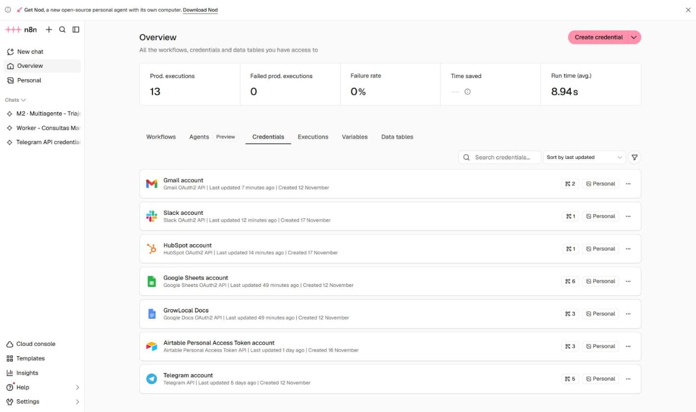

# M04 · Integraciones avanzadas (Gmail · HubSpot · Slack)

Checkpoint 4 del curso de Agentes de IA (Coderhouse). Parte del workflow del Módulo 3 (Manager + Workers + memoria en Airtable) y le suma tres herramientas reales conectadas por **OAuth2**: una casilla de correo (Gmail), un CRM (HubSpot) y un canal del equipo (Slack).

Archivo a importar en n8n: `checkpoint4_guillermo_fidelio.json`

## Credenciales conectadas



Las tres conexiones OAuth2 (Gmail, Slack y HubSpot) aparecen activas en la sección **Credentials** de n8n.

## Flujo

```
[Telegram]──────────────────────────────┐
                                        ▼
[Gmail Trigger]─▶[IF auto-reply]─No─▶[Normalizar entrada]─▶ Memoria (Airtable) ─▶ Agente Manager ─▶ Router ─▶ Workers
                        │ Sí                                                                                   │
                        ▼                                                                         ¿canal Telegram? ──Sí─▶ responde por Telegram
                 [Descartamos]                                                                                 │ No (email)
                                                                                                               ▼
   [Set: limpiar payload]─▶[¿email válido y ventas?]─Sí─▶[HubSpot Search]─▶[¿existe?]─Sí─▶[Update]──┐
                                   │ No                                                  └─No─▶[Crear]───┤
                                   └──────────────────────────────────────────────────────────────────────▼
                                                      [Set: payload mínimo]─▶[Slack #ops-expored]─▶[Gmail Create Draft]
```

## Los 4 controles que pide la consigna

1. **IF anti auto-reply (corta el bucle infinito).** Va inmediatamente después del Gmail Trigger. Descarta, con condiciones deterministas, asuntos con *Auto-reply, Out of office, Undeliverable, Respuesta automática, Fuera de la oficina* y remitentes *no-reply@, noreply@, donotreply@, mailer-daemon*. Lo descartado termina en el nodo `Descartamos - Ignoramos` y no llega a ninguna IA.
2. **Look up antes del Create (evita el Error 409).** `Search contacts (HubSpot)` busca por email y `¿Existe en CRM?` decide: si existe se actualiza, si no se crea. Solo corre con intención *ventas* y email válido.
3. **Create Draft (Human-in-the-loop).** El nodo de salida de correo es **solo** `Create Draft`: la respuesta del agente queda en Borradores de Gmail y una persona la revisa y envía. Ningún mail sale solo.
4. **Set de limpieza de payload (evita el Error 400 y satura menos Slack).** `Limpiar payload (Set)` deja solo email, nombre, asunto, cuerpo recortado, intención y respuesta, y valida que el email no esté vacío. `Payload mínimo Slack (Set)` envía a Slack solo texto corto, sin adjuntos ni binarios.

## Mínimo privilegio

- **Gmail:** se necesita leer la casilla y crear borradores. No se usa la operación de envío. El trigger además está acotado a mails con `[M4]` en el asunto, para no procesar correo ajeno.
- **HubSpot:** solo objetos de contactos (buscar y crear/actualizar).
- **Slack:** solo publicar mensajes en el canal `#ops-expored`.

## Test de regresión (Execute Workflow con datos de prueba)

| Caso | Resultado esperado | Resultado |
|---|---|---|
| Mail de ventas, contacto nuevo | Crea contacto en HubSpot, avisa en Slack, deja borrador | OK |
| Mismo contacto otra vez | Search → Existe → Update (sin Create, sin 409) | OK |
| Auto-reply (*Out of office* desde mailer-daemon) | Se descarta en el IF, no llega al Manager | OK |

## Cómo importarlo

1. En n8n: **Workflows → Import from file** y elegir el `.json`.
2. Reconectar las credenciales (Gmail, HubSpot, Slack, Telegram, Airtable, OpenAI, Google Sheets).
3. Reemplazar los placeholders: `TU_SHEET_ID` (planilla de log) y el chat id del aprobador en el nodo `Normalizar entrada` (`0`).

Por privacidad, el id de la planilla y el chat id de Telegram están reemplazados por placeholders.
